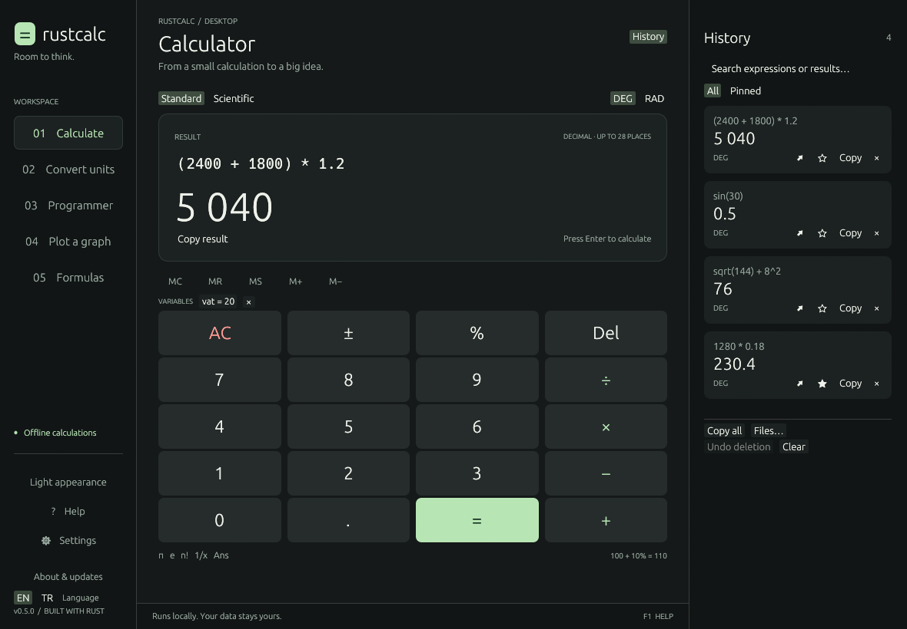
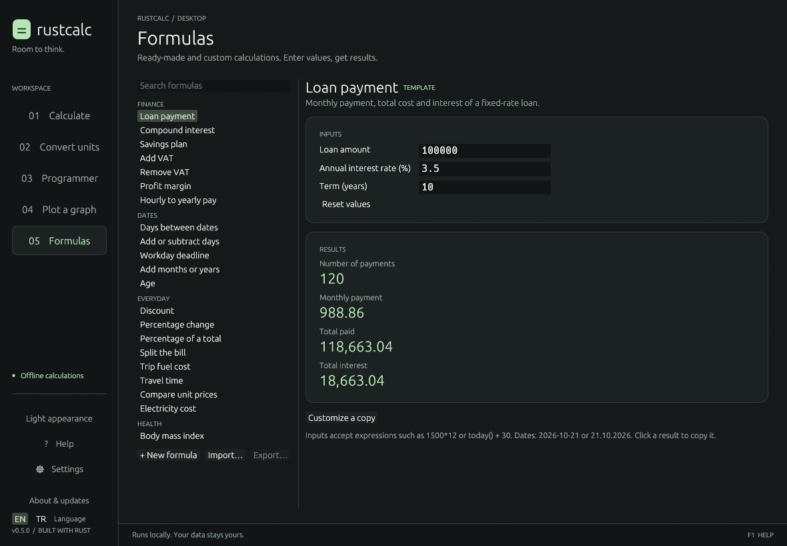
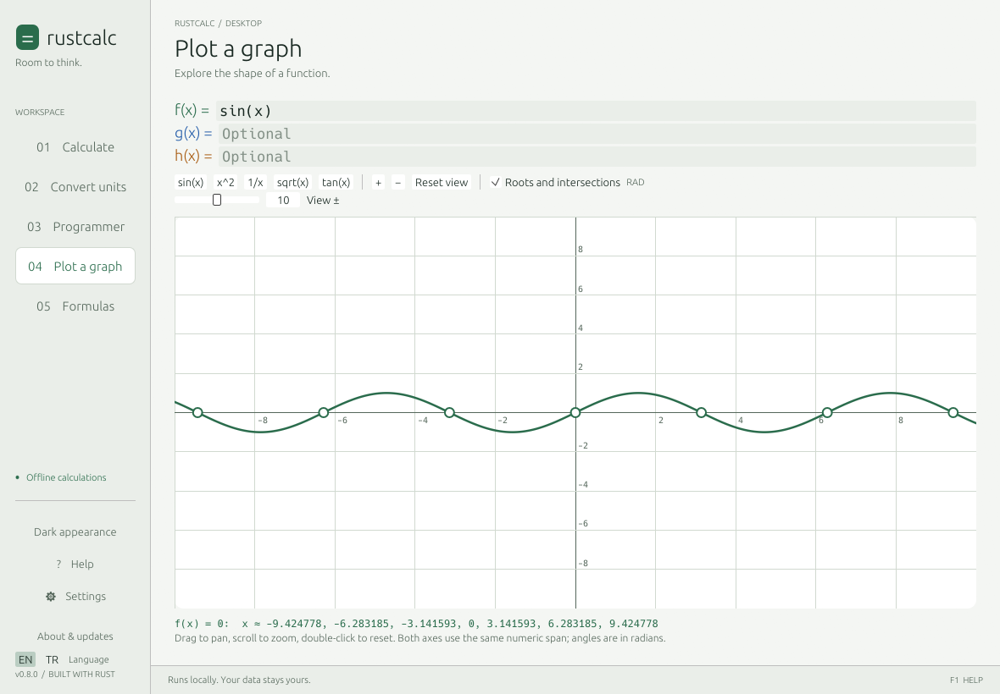
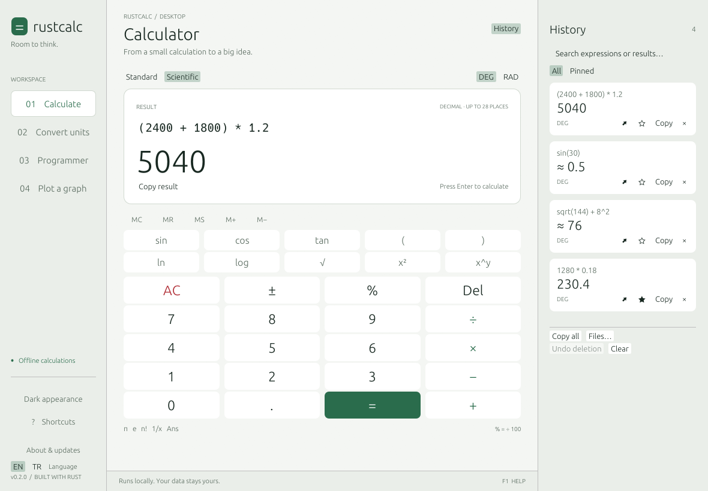
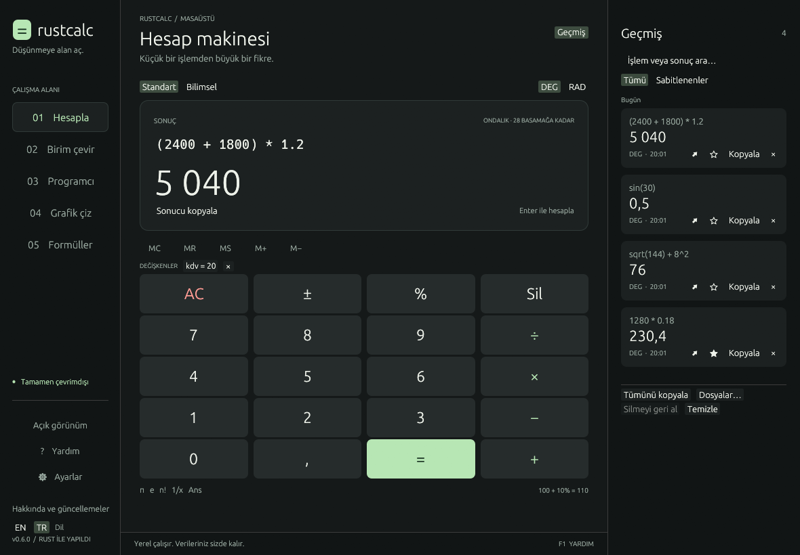
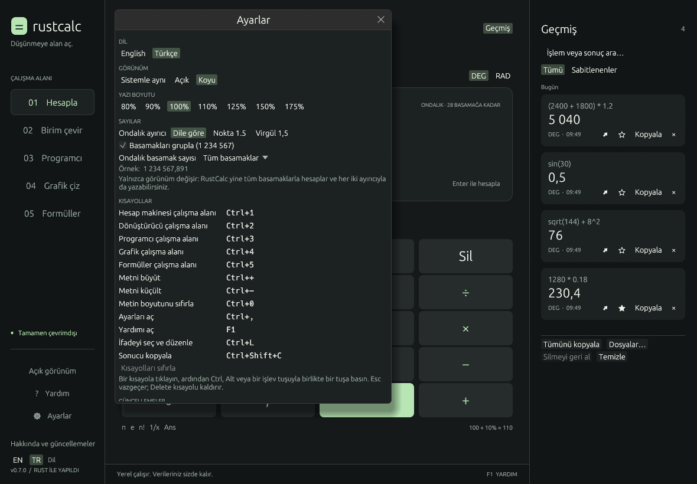

<div align="center">

# RustCalc

**Room to think. A native calculator built in Rust.**

[](https://github.com/ersinkoc/rustcalc/actions/workflows/check.yml)
[](LICENSE)
[](Cargo.toml)

Exact decimal arithmetic · Ready-made formulas · Date math · Unit conversion · Programmer tools · Function plots

[Download](https://github.com/ersinkoc/rustcalc/releases) · [User guide](docs/USER_GUIDE.md) · [Türkçe kullanım kılavuzu](docs/KULLANIM_KILAVUZU.md) · [Installation](#installation) · [Roadmap](docs/ROADMAP.md)

</div>



RustCalc is an open-source desktop calculator for **Windows, Linux and macOS**. You type whole
expressions, see the result while you type, and keep a searchable history. It
also has ready-made calculations for loans, VAT, dates and more, and lets you
build your own. Everything runs locally with no account, and the interface is
fully available in **English and Turkish** (switch with **EN / TR** in the
sidebar).

> Official binaries: Windows and Linux (x64 and ARM64) and macOS (Apple silicon and Intel).
> They are unsigned; the installers and updater verify SHA-256 checksums of
> published GitHub Releases.

## What you can do

| Workspace | What it is for |
| --- | --- |
| **01 Calculate** | Everyday and scientific calculations with a live result, variables, memory and history |
| **02 Convert units** | Length, mass, temperature, area, volume, speed, time, data, pressure, energy and power |
| **03 Programmer** | 8–64-bit integers in HEX/DEC/OCT/BIN, signed or unsigned, with a clickable bit map |
| **04 Plot a graph** | Up to three functions of `x`, with pan, zoom, roots and intersections |
| **05 Formulas** | 21 ready-made calculations (finance, dates, everyday, health) and your own formulas |

Press **F1** (or **? Help** in the sidebar) at any time for the built-in guide
with examples. **⚙ Settings** (Ctrl+,) sets the language, a light, dark,
high-contrast or system appearance, the text size, and how numbers are shown.

<details>
<summary>More screenshots: formulas, plots, settings, light theme, Turkish interface</summary>







</details>

## Quick start

1. [Install](#installation) RustCalc and open it.
2. Type `1250 * 12` — the result appears immediately. Press **Enter** to save it
   to the history on the right.
3. Type `+ 20%` and press Enter: the calculation continues from the last result
   (`ans + 20%` → 18000).
4. Open **05 Formulas → Loan payment**, enter an amount, rate and term, and read
   the monthly payment.

## The calculator in two minutes

**Typing.** You do not need to click the input first; just type. Press Enter or
`=` to save the result. Starting with an operator (`+`, `-`, `*`, `/`, `^`, `%`)
continues from the previous result. Esc clears.

**Order of operations** follows mathematics:

| You type | Result | Why |
| --- | --- | --- |
| `2 + 3 * 4` | `14` | Multiplication before addition |
| `(2 + 3) * 4` | `20` | Parentheses first |
| `2^3^2` | `512` | Powers group from the right: 2^(3^2) |
| `-2^2` | `-4` | The power applies before the minus; write `(-2)^2` for 4 |
| `2(3+4)`, `2pi` | `14`, `6.28…` | A number next to a bracket or name multiplies |

**Percent works like a shop calculator.** Adding or subtracting a percentage
changes a number by that share of itself:

| You type | Result | Meaning |
| --- | --- | --- |
| `100 + 10%` | `110` | 100 plus 10% of 100 |
| `100 - 10%` | `90` | 100 minus 10% of 100 (a discount) |
| `100 * 10%` | `10` | 10% of 100 |
| `100 / 10%` | `1000` | 100 divided by 0.1 |
| `10%` | `0.1` | On its own, a percentage is a fraction |
| `100 + 10% + 10%` | `121` | Each step uses the running total |
| `1200 + 20% - 50` | `1390` | Add 20% VAT, then subtract 50 |

**Decimals.** Use a comma *or* a period as the decimal point: `1,5` and `1.5`
are both one and a half. Never type thousands separators — `1,000` means 1.0,
not one thousand.

**Exact results.** Ordinary arithmetic is exact decimal arithmetic, so
`0.1 + 0.2` is `0.3` (many calculators show 0.30000000000000004). Results keep up
to 28 decimal places. A division that never ends, such as `1/3`, is marked ≈
(`≈ 0.333333333333333`), and `1/3*3` still gives `1`.

**≈ means approximate.** Functions such as `sqrt(2)`, `sin(1)` or `ln(2)` are
computed to about 15 significant digits and marked **≈**. Results that are
provably exact — `sqrt(144)`, `log(1000)`, `sin(30)` in degrees — show no ≈.
The marker is carried through `ans` and memory.

**Angles.** **DEG / RAD** at the top selects degrees or radians for `sin`, `cos`
and `tan` (`sin(30)` = 0.5 in DEG). Plots always use radians.

**Memory and answer.** `ans` is the last result. **MS** stores the current
result, **M+ / M−** add or subtract it, **MR** inserts `mem`, **MC** clears.

### Functions

| Kind | Functions |
| --- | --- |
| Roots, powers, logs | `sqrt`, `cbrt`, `exp`, `ln`, `log` (base 10), `log(x; base)` |
| Trigonometry | `sin`, `cos`, `tan`, `asin`, `acos`, `atan`; hyperbolic `sinh`, `cosh`, `tanh`, `asinh`, `acosh`, `atanh` (ignore DEG/RAD) |
| Rounding | `abs`, `floor`, `ceil`, `round(x)`, `round(x; digits)`, `sign` |
| Lists | `min`, `max`, `sum`, `avg` — e.g. `max(4; 9; 2)` |
| Integers | `gcd`, `lcm`, `mod(a; b)`, `ncr(n; k)`, `npr(n; k)`, factorial `n!` (0–27) |
| Logic | Comparisons `<  >  <=  >=  ==  !=` give 1 or 0; `if(cond; a; b)`, `and`, `or`, `not` |
| Dates | `today()`, `date(y; m; d)`, `addmonths`, `addworkdays`, `years`, `workdays` … ([all](docs/FORMULAS.md#dates)) |
| Constants | `pi`, `e`, `ans`, `mem` |

Separate arguments with **`;`** because the comma is a decimal point.
`round` rounds halves up, as at school (`round(2.5)` = 3, `round(1234; -2)` =
1200). Dates are day numbers, so
`date(2026; 12; 31) - today()` is the number of days until New Year's Eve.

## Formulas

**05 Formulas** holds ready-made calculations: loan payment, compound interest,
savings plan, add/remove VAT, profit margin, hourly to yearly pay, days between
dates, add days, workday deadline, add months, age, discount, percentage change
and share, bill split, trip fuel cost, travel time, unit prices, electricity cost
and BMI. Choose one, type your values and read the results; inputs also accept
expressions such as `1500*12` or `today() + 30`, and date fields accept
`2026-10-21` or `21.10.2026`. Click a result to copy it.

**+ New formula** builds your own: name the inputs, write result expressions that
can use the inputs and earlier results, and choose how each result is shown
(number, money, percent, date or weekday). The editor checks your formula and
previews results as you type. **Customize a copy** turns a template into your own
editable formula, and **Export… / Import…** share formulas as files. See the
[formula guide](docs/FORMULAS.md).

## Other workspaces

- **Convert units** — choose a category, type the value, pick both units;
  **Swap units** reverses the direction. Factors are exact definitions
  (1 mile = 1609.344 m, 1 atm = 101.325 kPa); data sizes offer both SI (kB) and
  binary (KiB) units. The value may be an expression such as `1500*12`.
  **In every unit** lists the value in each unit of the category; choose a row
  to make it the target.
- **Programmer** — choose 8, 16, 32 or 64 bits and **Signed** for two's
  complement. Type in HEX, DEC, OCT or BIN, click bits to flip them, and use the
  second operand for `+ − × ÷ MOD AND OR XOR` and shifts. Results wrap like
  hardware integers.
- **Plot a graph** — enter up to three functions of `x` (f, g, h). Drag to move,
  scroll to zoom, double-click to reset; roots and intersections are marked and
  listed. Poles such as `1/x` are not joined by false vertical lines.
- **Variables** — type `vat = 20`, then use `vat` in later calculations
  (`1500 + vat%` = 1800), plots and conversions. Variables are saved and shown
  under the result; click one to insert it, × to delete it.
- **Number display** — results are grouped (`1 234 567,89`) and use a decimal
  comma in Turkish. In Settings you can choose the decimal mark, turn grouping
  off or fix the number of decimals. Only the display changes; copied results
  have no grouping, so they paste back.
- **History** — search and pin entries; click a result to reuse it or **↗** to
  edit its expression again. **Files…**
  saves a JSON backup, exports text or imports a backup; **Undo deletion**
  restores removed entries during the session. See [history backups](docs/HISTORY.md).

The [user guide](docs/USER_GUIDE.md) covers every workspace in detail.

## Frequently asked questions

**Why is `100 + 10%` 110 and not 100.1?** RustCalc follows the convention of
shop and phone calculators: `+ 10%` means "add ten percent". On its own `10%`
is 0.1, and `100 * 10%` is 10. Versions before 0.5 divided by 100 everywhere.

**Why does `0.1 + 0.2` give exactly 0.3?** Arithmetic uses decimal numbers rather
than binary floating point, so everyday amounts add up the way they do on paper.

**What does ≈ mean?** The result was rounded to about 15 significant digits by a
scientific function. Exact results never show it.

**Why is `1,000 + 1` equal to 2?** The comma is a decimal point, so `1,000` is 1.
Type numbers without thousands separators: `1000 + 1`.

**Why does `tan(90)` give an error?** The tangent of 90° is undefined. Errors are
shown under the result instead of a misleading huge number.

**Where is my data?** History, memory, settings and your formulas are in
`%APPDATA%\RustCalc\data\app.ron` on Windows, `~/.local/share/rustcalc/app.ron`
on Linux and `~/Library/Application Support/RustCalc/app.ron` on macOS. Updates
and uninstalling keep it.

## Installation

| System | Install with | Or download |
| --- | --- | --- |
| Windows x64 | `install.ps1` | `rustcalc-windows-x86_64.exe` or the ZIP |
| Windows ARM64 | `install.ps1` | `rustcalc-windows-aarch64.exe` or the ZIP |
| Linux x64 | `install.sh` | `rustcalc-linux-x86_64` or the tar.gz |
| Linux ARM64 | `install.sh` | `rustcalc-linux-aarch64` or the tar.gz |
| macOS, Apple silicon | `install.sh` | `rustcalc-macos-aarch64` or the tar.gz with `RustCalc.app` |
| macOS, Intel | `install.sh` | `rustcalc-macos-x86_64` or the tar.gz with `RustCalc.app` |

No administrator access is needed. See [installation details](docs/INSTALLATION.md)
for options, offline installs, removal and troubleshooting.

### Windows

Download and inspect the installer, then run it in PowerShell.

```powershell
Invoke-WebRequest https://raw.githubusercontent.com/ersinkoc/rustcalc/main/install.ps1 -OutFile install-rustcalc.ps1
# Review install-rustcalc.ps1 before running it.
& .\install-rustcalc.ps1
rustcalc
```

The installer uses `%LOCALAPPDATA%\Programs\RustCalc`, creates a Start menu
shortcut, and adds its `bin` directory to your user PATH. Downloads are checked
against `SHA256SUMS` and version-verified before anything is installed.

```powershell
& .\install-rustcalc.ps1 -Version 0.4.0
& .\install-rustcalc.ps1 -InstallDir "$env:LOCALAPPDATA\Tools\RustCalc"
& .\install-rustcalc.ps1 -NoPath -NoShortcut
```

### Linux and macOS

```sh
curl -fsSLO https://raw.githubusercontent.com/ersinkoc/rustcalc/main/install.sh
# Review install.sh before running it.
sh install.sh
rustcalc
```

The installer picks the right binary, verifies it against `SHA256SUMS` and its
version, installs it to `~/.local/opt/rustcalc`, links `~/.local/bin/rustcalc`,
and adds a menu entry (Linux) or `~/Applications/RustCalc.app` (macOS). It never
edits your shell startup files. Uninstall with
`sh ~/.local/opt/rustcalc/uninstall.sh`.

On macOS, a `RustCalc.app` downloaded with a browser is unsigned, so open it the
first time with Control-click → **Open**. Apps installed by `install.sh` are not
affected.

### Portable

Download the binary or archive for your system from
[GitHub Releases](https://github.com/ersinkoc/rustcalc/releases), check it against
the release's `SHA256SUMS`, and run it from any folder.

### Build from source

Requires Rust 1.88+ and a C compiler (Visual Studio C++ build tools with a
Windows SDK on Windows, `gcc` or `clang` on Linux, Xcode command-line tools on
macOS).

```powershell
git clone https://github.com/ersinkoc/rustcalc.git
cd rustcalc
cargo run --release --locked
```

## Updates

Open **About & updates → Check for updates**, review the version and select
**Install update**, then restart.

Automatic updates are off until you choose otherwise. On first launch the status
bar asks once; you can change it later under **About & updates → Automatic
updates**:

| Mode | Behavior |
| --- | --- |
| Off | Never connects unless you check manually |
| Notify me | Checks at most once a day and shows **Update to x.y.z** in the status bar |
| Install automatically | Checks daily, downloads, verifies and installs; **Restart to update** applies it |

RustCalc never restarts itself. Each update keeps the replaced program beside
it (`rustcalc.previous.exe` on Windows, `rustcalc.previous` elsewhere);
`rustcalc update --rollback` restores it, and running it again returns to the
newer version. Updates work the same on Windows, Linux and macOS.

```powershell
rustcalc --version
rustcalc update --check     # Check only
rustcalc update             # Download, verify and install
rustcalc update --rollback  # Go back to the version the last update replaced
```

Only newer stable versions from `ersinkoc/rustcalc` are accepted, and every
download must match the release checksums and run with the expected version
before it replaces anything. Read the [update design and trust model](docs/UPDATES.md).

## Keyboard

| Shortcut | Action |
| --- | --- |
| Enter or `=` | Calculate and save to history |
| Esc | Clear the expression |
| Ctrl+L | Select the expression |
| Ctrl+Shift+C | Copy the result |
| Ctrl+C / Ctrl+V / Ctrl+Z | Standard text editing |
| F1 | Help and guide |
| Ctrl+1 … Ctrl+5 | Switch workspaces |
| Ctrl+, | Settings |
| Ctrl++ / Ctrl+− / Ctrl+0 | Larger, smaller or default text size |

These are the defaults: change any of them under **Settings → Shortcuts**.

Over a plot: arrow keys move, `+` / `-` zoom, Home resets.

```powershell
rustcalc --lang tr        # Start in Turkish (saved)
rustcalc --compact        # Smaller window
rustcalc --light          # Light appearance
rustcalc --high-contrast  # High-contrast appearance
rustcalc --formulas       # Open the Formulas workspace
rustcalc --help
```

## Privacy

Everything works offline. There is no telemetry, account, advertising or
analytics. GitHub is contacted only for update checks you request or enable, and
calculations are never sent. State is saved locally every few seconds and on
exit; the expression you are typing is not saved.

## Development

```powershell
cargo fmt --all -- --check
cargo clippy --all-targets --locked -- -D warnings
cargo test --all-targets --locked
cargo build --release --locked
pwsh -NoProfile -File scripts/test-install.ps1   # Windows
pwsh -NoProfile -File scripts/package.ps1        # Windows
sh scripts/test-install.sh                       # Linux, macOS
sh scripts/package.sh                            # Linux, macOS
```

Tests cover arithmetic, percent rules, dates, formulas, conversion, history,
both languages (including a check that no Turkish screen shows untranslated
text), persistence, updater integrity and rollback, and keyboard/pointer
interaction. CI runs them on Windows, Linux and macOS, together with the
installer tests (`scripts/test-install.ps1` and `scripts/test-install.sh`). See [contributing](CONTRIBUTING.md), [architecture](docs/ARCHITECTURE.md),
[localization](docs/LOCALIZATION.md) and [releasing](docs/RELEASING.md).

## Status and limitations

RustCalc is an early but complete desktop application. Official binaries cover
Windows and Linux on x64 and ARM64 and macOS, and are unsigned. Controls carry
screen-reader names; full NVDA, Orca and VoiceOver passes are pending. There is no
symbolic algebra, arbitrary precision or currency conversion. Workday
calculations skip weekends but do not know public holidays. Planned work is in
[the roadmap](docs/ROADMAP.md).

## License

[MIT](LICENSE) © 2026 [Ersin Koç](https://github.com/ersinkoc).
