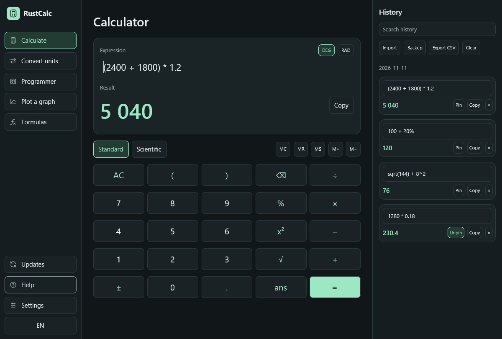

RustCalc 0.9.0 brings a new [GPUI](https://gpui.rs/) interface to all five workspaces, a redesigned app icon, and graphical Windows installers.

## What's new

- The calculator keeps a live result and searchable history alongside the keypad on wide displays. Compact windows open history on demand.
- The converter, programmer, function plotter, and formula library use the same responsive layout and support English, Turkish, light, dark, and high-contrast appearances.
- Windows Setup installs for the current user and registers RustCalc in Installed apps. It offers Start menu, desktop, and PATH options and can adopt an existing PowerShell installation.
- **Updates** lets you check, install, restart, and restore a previous version. The application keeps the existing notebook across installation, update, and removal.

## Downloads

- [Windows x64 Setup](https://github.com/ersinkoc/rustcalc/releases/download/v0.9.0/rustcalc-v0.9.0-windows-x86_64-setup.exe)
- [Windows ARM64 Setup](https://github.com/ersinkoc/rustcalc/releases/download/v0.9.0/rustcalc-v0.9.0-windows-aarch64-setup.exe)
- Windows portable ZIPs, Linux archives, and macOS app bundles are listed below. [Verify the SHA-256 checksums](https://github.com/ersinkoc/rustcalc/releases/download/v0.9.0/SHA256SUMS).

The binaries are unsigned. Screen-reader integration for the GPUI interface remains pending.

[Installation guide](https://github.com/ersinkoc/rustcalc/blob/v0.9.0/docs/INSTALLATION.md) · [Full changelog](https://github.com/ersinkoc/rustcalc/compare/v0.8.0...v0.9.0)
