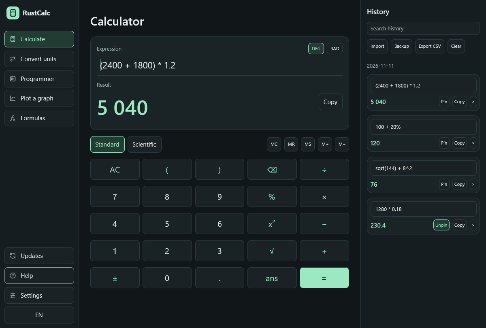

RustCalc 0.9.1 updates the GPUI layout dependency to Taffy 0.9.2 and grid 1.0.1.
The grid update includes the fix for an integer overflow in `Grid::expand_rows`.
[Upstream advisory](https://github.com/advisories/GHSA-38c5-483c-4qqp)

## Install or update

- [Windows x64 Setup](https://github.com/ersinkoc/rustcalc/releases/download/v0.9.1/rustcalc-v0.9.1-windows-x86_64-setup.exe)
- [Windows ARM64 Setup](https://github.com/ersinkoc/rustcalc/releases/download/v0.9.1/rustcalc-v0.9.1-windows-aarch64-setup.exe)
- Existing installations can use **Updates → Check for updates** or `rustcalc update`.
- Windows portable ZIPs, Linux archives, and macOS app bundles are available below.
  [SHA-256 checksums](https://github.com/ersinkoc/rustcalc/releases/download/v0.9.1/SHA256SUMS)

The binaries are unsigned. Screen-reader integration for the GPUI interface remains pending.

[Full changelog](https://github.com/ersinkoc/rustcalc/compare/v0.9.0...v0.9.1)
