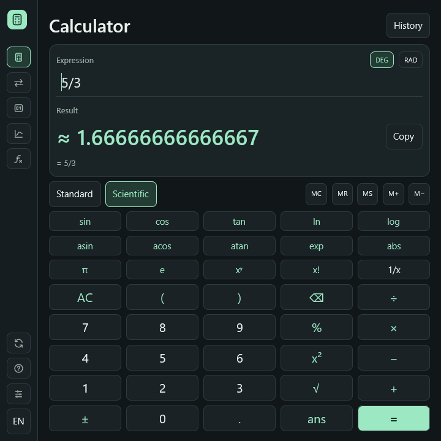

RustCalc 0.9.2 fixes calculator keys being cut off in small windows.

- The minimum window client size is now **720 × 720 logical pixels**.
- Short windows use compact display spacing and keypad heights, keeping every
  standard and scientific key visible at the default text size.
- Keypad heights follow the selected text size.
- A rendered-layout regression test checks every key at the minimum and default
  window sizes.

## Install or update

- [Windows x64 Setup](https://github.com/ersinkoc/rustcalc/releases/download/v0.9.2/rustcalc-v0.9.2-windows-x86_64-setup.exe)
- [Windows ARM64 Setup](https://github.com/ersinkoc/rustcalc/releases/download/v0.9.2/rustcalc-v0.9.2-windows-aarch64-setup.exe)
- Existing installations can use **Updates → Check for updates** or `rustcalc update`.
- Windows portable ZIPs, Linux archives, and macOS app bundles are available below.
  [SHA-256 checksums](https://github.com/ersinkoc/rustcalc/releases/download/v0.9.2/SHA256SUMS)

The binaries are unsigned. Screen-reader integration for the GPUI interface remains pending.

[Full changelog](https://github.com/ersinkoc/rustcalc/compare/v0.9.1...v0.9.2)
